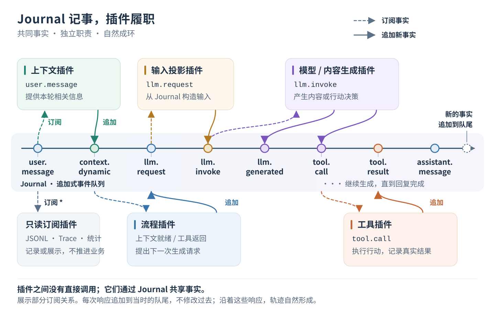
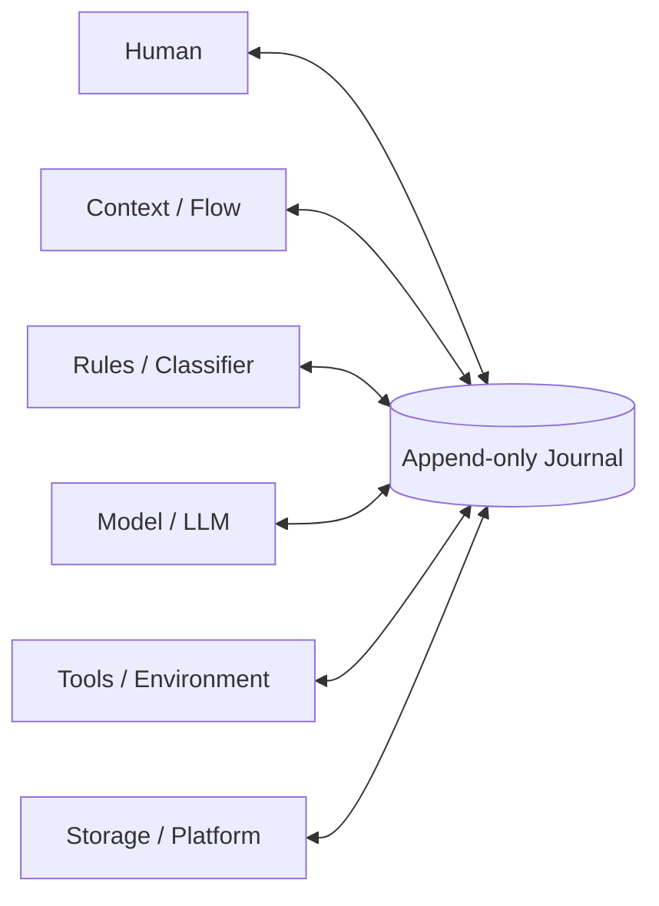
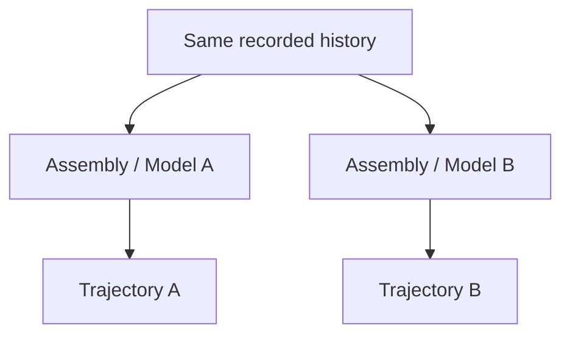
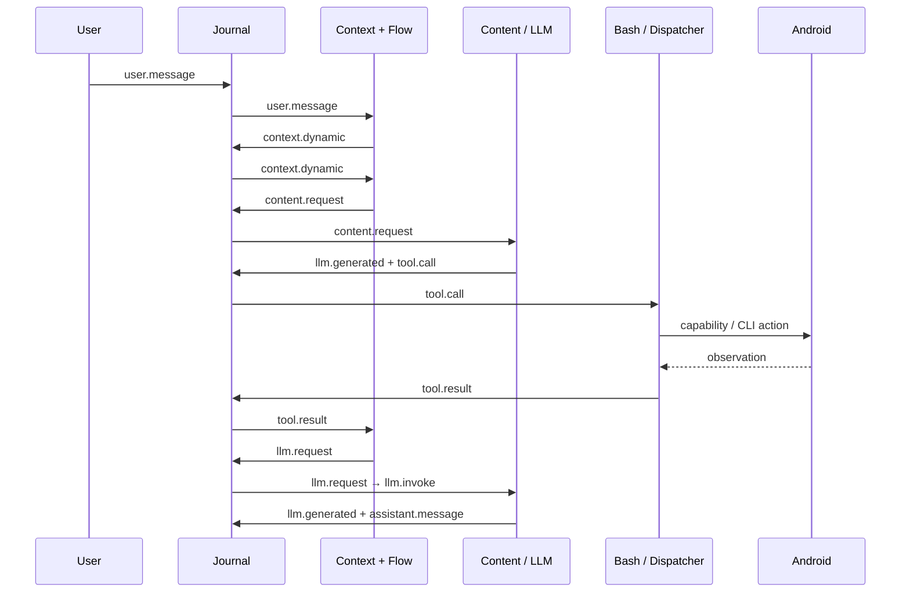
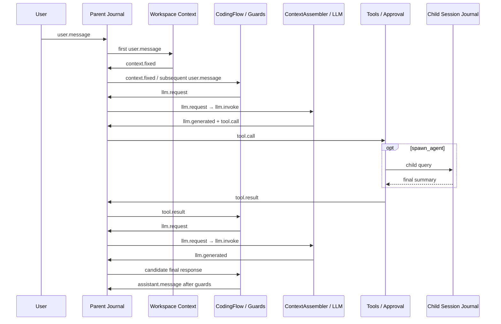

# Knot

**An agent runtime and experimentation platform without a central AgentLoop.**

Beyond a tiny Journal kernel, **capabilities are plugins**. Each plugin subscribes to events it cares about, does its job, and appends new events—or stays silent. No central loop coordinates every piece of business logic, yet the agent keeps running.

Plugins do not call one another or need their own separate business memory. Models, context, tools, approvals, storage, and platform capabilities cooperate around a shared history. The model is a participant, not a privileged center: rules, classifiers, small models, ordinary programs, and humans can all move things forward.

That growing history is the **Journal**. It records more than what an agent did: it holds the business facts the agent runs on. Models receive context projected from it; plugins reconstruct the state they need; developers inspect execution, investigate failures, and build experiments from the same record.

**People, models, and software tie knots in a shared history. As events unfold, an agent's trajectory takes shape.**

> **The Journal remembers. The Agent is the trajectory.**

[中文](README.md) · [Core concepts and semantics](docs/concepts.md) · [Plugin best practices](docs/plugin-best-practices.md)

> **Alpha**: Android assistant (CASE1), coding agent (CASE2), and Web Run using the official DSH frontend shell have been exercised. The focus is real usage and a better workbench; public plugin APIs and experiment capabilities are still evolving.



## Why another agent harness?

An agent often starts as a simple loop: build context, call a model, execute tools, and feed the results back.

Then come memory, approvals, permissions, compression, retries, subagents, session recovery, UI, and domain-specific behavior. More responsibilities move into the same AgentLoop. The center learns about every component, and independent changes become harder.

Knot explores a different way to organize that growth.

- **Flow is not hardcoded**: independent plugins react to events; the next step emerges from their responses.
- **Business state is not scattered**: facts affecting subsequent behavior belong in the Journal, not hidden across plugin instances.
- **Protocols replace direct calls**: a tool understands `tool.call` and produces `tool.result`. It need not know who continues afterward.
- **Capabilities have no kernel privileges**: models, tools, guards, storage, and platform adapters all participate through assembly.

Think of an organization: people act on what has happened and fulfill their own responsibilities without knowing how the whole company works. **Assemble the participants, and work moves forward.**

## How an agent takes shape

A typical Android assistant trajectory:

```text
user.message
  → context.dynamic
  → content.request
  → llm.request
  → llm.invoke
  → llm.generated
  → tool.call
  → tool.result
  → llm.request
  → …
  → assistant.message
```

It looks like an AgentLoop, but those arrows **are not in the Journal kernel**. Context reacts to a user message, a content source handles the request, tools execute calls, and flow reacts to results when more generation is needed.



Participants cooperate through event protocols, not direct plugin calls. When no new events are produced, the Journal drain naturally becomes idle.

### A plugin need not know another plugin exists

```js
const reply = journal => {
  journal.subscribe('user.message', event => {
    journal.append('assistant.message', {
      content: `You said: ${event.data.content}`,
    })
  })
}

const print = journal => {
  journal.subscribe('assistant.message', event => {
    process.stdout.write(`${event.data.content}\n`)
  })
}
```

`reply` never calls `print`; `print` does not know `reply` exists. A real agent uses the same mechanism with more participants.

Run the [single-file minimal example](examples/minimal.mjs):

```bash
npm install
npm run example:minimal -- "hello"
```

### An LLM is one possible content source

CASE1's content mechanism tries shortcut rules first and calls the model when no rule answers. A classifier, smaller model, or human decision can participate through the same event mechanism.

Knot does not need a unique control center for model decisions. **Whoever can fulfill the responsibility can contribute the next fact.**

## More than a trace

A trace usually describes execution for later inspection. In Knot, **the Journal participates in execution**: plugins read history, model input is projected from it, and tool observations return to it.

```text
                    ┌── Model context
                    ├── Runtime state / Session recovery
Append-only Journal ├── UI / Todo / Tool trajectory
                    ├── Debug / Failure analysis
                    └── Case / Eval / Dataset
```

Plugins own behavior; the Journal holds business facts. Assembly determines the participants, and history supplies the known conditions from which they continue.

That lets several activities share a common representation:

- **Execution and recovery**: rebuild a session's business views from recorded facts.
- **Investigation**: inspect model inputs, tool results, and execution paths—not just final answers.
- **Experiments**: extract a case from real history and investigate changes to a provider, rule, or assembly.
- **Data production**: keep model inputs, human interventions, observations, and results connected.



This illustrates the **experimental direction**, not a claim that arbitrary-node forks or controlled replay of all external effects are productized. See [core concepts](docs/concepts.md) for recovery, model nondeterminism, and side effects.

## Two very different agents, one kernel

The Android assistant and coding agent share the same **56-line Journal kernel**. What changes is the assembly: plugins, tools, context, and execution environment.

| | CASE1: Android assistant | CASE2: Coding agent |
|---|---|---|
| Workload | Frequent requests, short context, bounded actions | Long-running tasks, open workspace, many tool calls |
| Capabilities | Intent-matched context, Bash/CLI, device execution | File editing, Shell, approvals, Todo/Goal, subagents |
| Content sources | Rules and LLM | Long-context reasoning and successive tool use |
| Validation | Consecutive requests on a USB-connected phone | Multi-stage development in a real repository |

### CASE1: Android device assistant

CASE1 does not put Android business logic in a central loop. The system prompt and Bash function schema stay stable; intent matching supplies relevant apps and CLI instructions for the current query. Catalog, parser, and dispatcher then route the command to a device handler.



**2026-09-25, one consecutive USB-device session:**

| Metric | Result |
|---|---:|
| User requests / distinct CLI commands | **66 / 56** |
| Expected tool paths reached | **65 / 66** |
| Uncaught runtime exceptions | **0** |
| Model generations | **133**, or 2.02 per request |
| Input per model call | Mean **6,055 tokens**, maximum 10,638 |
| Output per model call | Mean **27.8 tokens** |
| Request duration, excluding deliberate waits | Mean **2.47 s**, P95 **5.09 s** |
| Journal | **880 events / ~282 KB** |

This record includes business failures: phone-number formatting, nearby search, and some ADB capabilities returned errors. Those errors became `tool.result` facts, allowing the model to explain, retry, or degrade without breaking the runtime.

```bash
npm run case1
# After configuring a real Provider and connecting an Android device:
npm run smoke:case1-adb
```

Without Provider environment configuration, `npm run case1` uses a mock model and mock tools and needs no API key.

### CASE2: Coding agent

CASE2 has a different workload: repository files, open-ended Shell commands, approvals, Ask, Todo, Goal, history compression, and persistent subagents.

There is still no all-knowing coding AgentLoop. `CodingFlow` responds when another generation or a final response is needed; tools, guards, and storage remain separate. A subagent has its own Journal, model configuration, and working directory; the parent receives its result.



**2026-09-20, a real development task:** `deepseek-flash` explored a 5G discrete-event simulator, added UE traffic and network-element capacity models, then implemented ingress flow control and periodic retries. One architecture investigation was delegated to a subagent. Tests grew from **40 to 67**, all passing.

| Metric | Parent | Subagent |
|---|---:|---:|
| Model generations | 140 | 7 |
| Tool calls | 145 | 15 |
| Journal events | 783 | 47 |
| Last model input | 151,364 tokens | 30,673 tokens |
| JSONL size | ~1.03 MB | ~236 KB |

The record demonstrates an open-ended coding workload on the same event model, while exposing practical optimization targets: context organization, tool-result budgets, and reasoning cost.

```bash
export KNOT_BASE_URL="https://example.com/v1"
export KNOT_MODEL="model-name"
export KNOT_API_KEY="..."
npm run case2 -- "Inspect this project and run its tests"
```

CASE2 reads, modifies, and executes files in its working directory. Use an appropriate workspace.

> These figures are historical engineering records from saved Journals and code snapshots, not standardized cross-project benchmarks. See the [CASE1 boundaries](docs/design/case1-active-boundaries.md) and [CASE2 design](docs/design/case2-coding-agent-spec.md).

## Workbench: see how an agent runs

Knot connects the **official DSH frontend shell** to Knot Host. Agent execution, model calls, tools, and Journal progression remain Knot's responsibility; no DSH AgentLoop is activated. See the frontend [NOTICE](web-dsh-reference/NOTICE.md) for dependencies and attribution.

An [earlier screenshot of Knot's own Web UI](docs/assets/knot-workbench.png) is retained as a historical record, not as the current DSH interface.

Web Run currently supports:

- Session creation, selection, and recovery; streamed content, reasoning, tool calls, and results.
- Native approval, Ask, Todo, read-only Goal, child-session navigation, and queue/steer input.
- Files, images, workspace path references, and process tools for background commands.
- Chat / Trajectory, raw Journal, tool analytics, context analysis, and plugins/protocols views.
- Session Overview with configuration, usage, Todo/Goal, and a query directory.

```text
DSH Web / Client Cordis
          ↓  projection + RPC/SSE
       Knot Host
          ↓
       Assembly
          ↓
  Plugins ↔ Journal
```

### Quick start

Requires **Node.js 22.18+**.

```bash
npm install
npm --prefix web-dsh-reference install
npm start
```

Open <http://127.0.0.1:4317/>, configure a DeepSeek or OpenAI-compatible Provider in **Settings → 模型 Provider**, and create a Session.

Credentials saved through Settings stay in the local `.knot/` configuration. Provider responses are redacted, and keys are not written to the Journal. See the [frontend integration guide](web-dsh-reference/README.md) and [`.env.example`](.env.example).

## Tiny kernel, assembled capabilities

[`src/journal.ts`](src/journal.ts) is **56 lines with no imports**. It knows nothing about models, tools, prompts, sessions, approvals, or UI.

```ts
type Event = { readonly type: string; readonly data: unknown }
type Handler = (event: Event) => void | Promise<void>
type Plugin = (journal: Journal) => void

interface Journal {
  append(type: string, data: unknown): Event
  read(): readonly Event[]
  subscribe(type: string, handler: Handler): void
}
```

Start with three concepts:

- **Journal**: the shared history of business facts.
- **Plugin**: a participant that subscribes, acts, and appends facts—or stays silent.
- **Assembly**: the participants and their arrangement that form a particular agent.

Projection, reaction, effects, delivery order, exception handling, state ownership, and safety have precise contracts, but need not be mastered before reading the introduction. See [concepts and semantics](docs/concepts.md).

## From execution to experiments

Sessions, Journals, model context, tool trajectories, and basic Case/Run capabilities provide a starting point for a shared development workflow:

```text
Real task → Saved Journal → Observed failure
                                  ↓
                 Inspect context and tool results
                                  ↓
                  Extract a case / Change assembly
                                  ↓
                    Validate a new trajectory
```

The direction is not to build unrelated debugger, eval runtime, and dataset infrastructures. It is to let execution, observation, experiments, and analysis **share a common representation of facts**. Arbitrary historical forks, controlled effect replay, and full dataset evaluation remain future work.

## Current boundaries

The philosophy and implementation scope are distinct:

- **State and the outside world**: business facts belong in the Journal; connections, processes, and caches are execution resources. Devices still own device state. Some in-memory workflow state remains to be consolidated.
- **Recovery and experiments**: sessions can be loaded and historical model inputs rebuilt. This does not restore external systems, automatically repeat uncertain effects, or guarantee identical model answers. Full experiment comparison and Dataset Eval are not productized.
- **Safety**: approvals are not a sandbox; pausing is not process termination. More complete failure recovery and runtime protections remain work in progress.
- **Ecosystem**: internal `definePlugin` / `defineAssembly` serve real assemblies, but public APIs are not frozen and there is no plugin marketplace.

## Knots and trajectories

“Knot” comes from keeping records by tying knots. Models leave generations, tools leave observations, rules leave judgments, and people leave clarifications and decisions. They need not share implementations to continue along the same history.

“Trajectory” is another favorite image, partly inspired by Falcom's *Trails in the Sky*: something happens, different characters respond from their own positions, and the world has changed when you return.

That is the collaboration Knot explores: **no participant knows the whole story, yet their local actions can move it forward.**

**The Journal remembers. The Agent is the trajectory.**

## Documentation and participation

- [Core concepts and semantics](docs/concepts.md)
- [Plugin design and best practices](docs/plugin-best-practices.md)
- [DSH frontend integration](web-dsh-reference/README.md)
- [Workbench product model](docs/product/workbench-product-model.md)
- [Workbench user stories](docs/product/workbench-user-stories.md)
- [CASE1 boundaries](docs/design/case1-active-boundaries.md)
- [CASE2 coding agent design](docs/design/case2-coding-agent-spec.md)

```bash
npm test
```

Contribute a real agent case, a reproducible context/tool failure, a focused plugin, or a model/assembly comparison. Read [`AGENTS.md`](AGENTS.md) first: **start from real trajectories and observed problems before adding mechanisms.**
