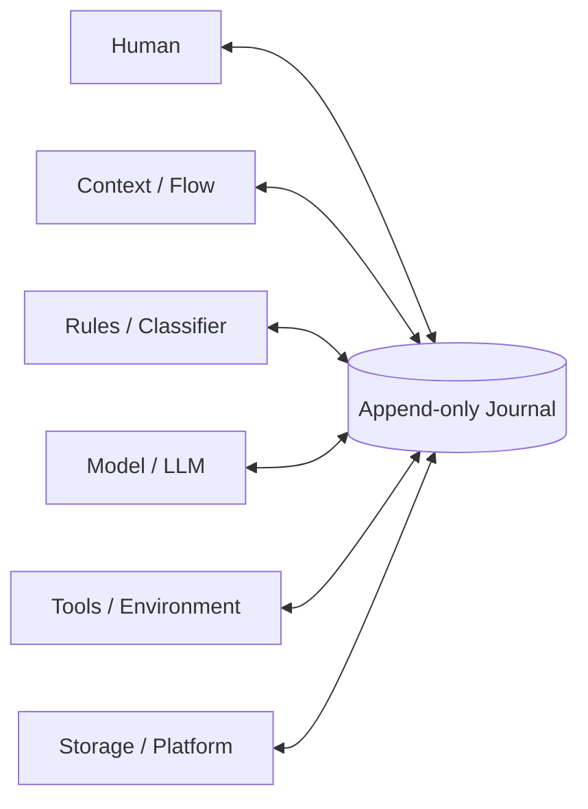
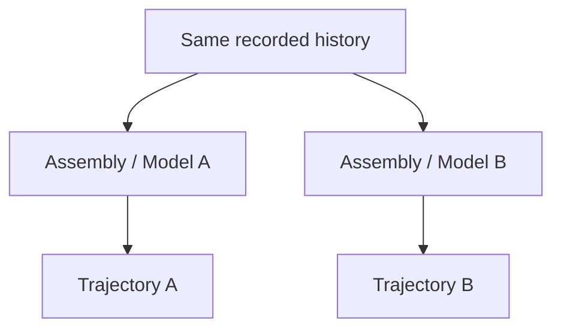
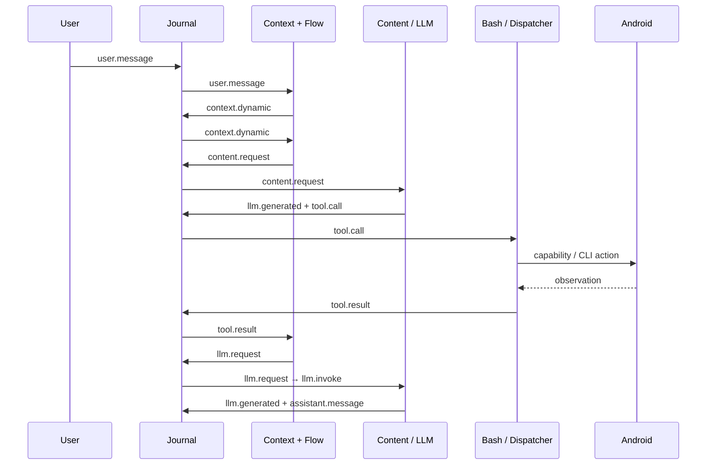
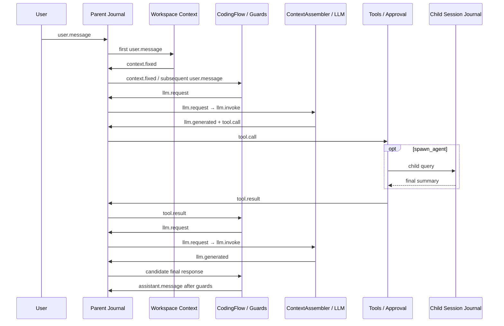
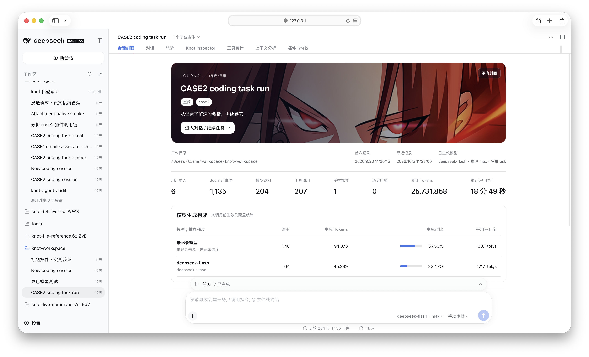
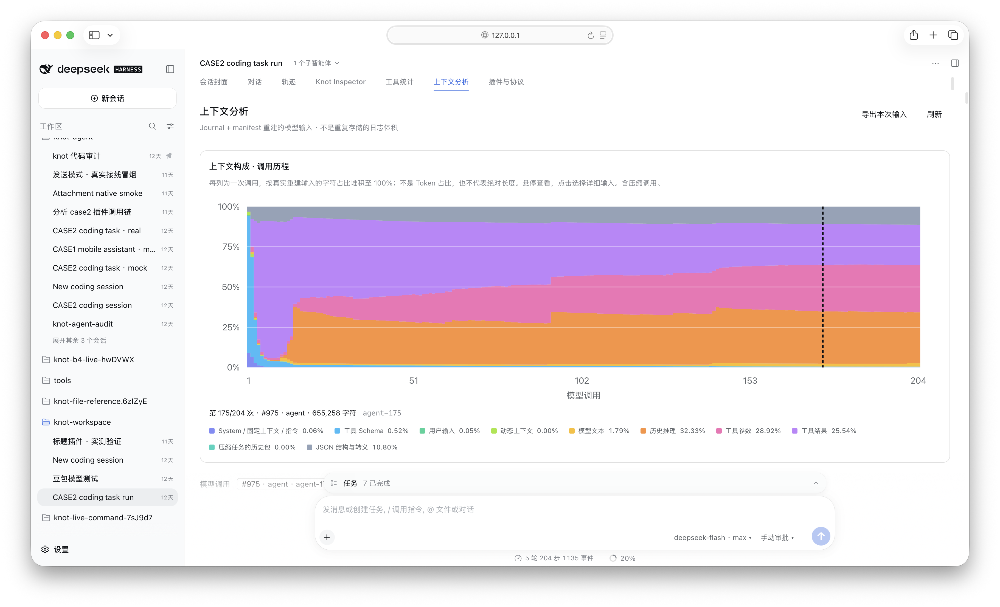
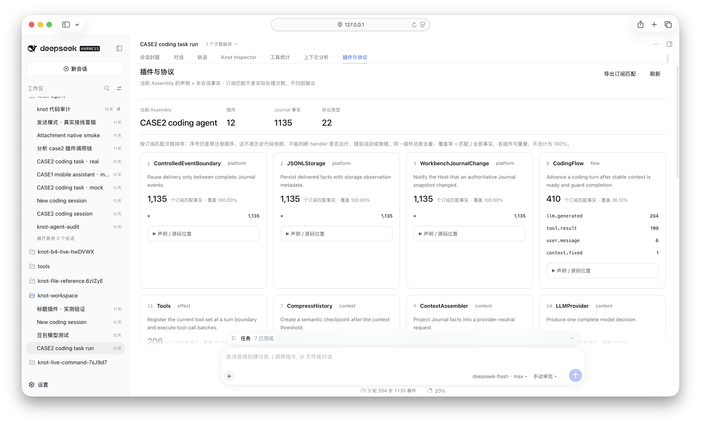

# Knot

**一个没有中央 AgentLoop 的智能体运行时与实验平台。**

除极小的 Journal 内核外，**一切能力皆插件**。每个插件订阅自己关心的事件，完成自己的职责，再追加新的事件，或者保持沉默。没有一个中央循环负责调度全部业务，Agent 却能持续运行。

插件不直接调用彼此，也不需要保存独立的业务状态。模型、上下文、工具、审批、存储乃至平台能力都可以围绕同一份事件历史协作；模型并不是必选的中心，规则、分类器、小模型、普通程序，甚至人类，都可以推动下一步。

这条不断增长的共同历史叫 **Journal**。它不仅记录 Agent 做过什么，也承载其运行时的业务事实：模型从中获取上下文，插件从中恢复所需状态，开发者从中观察执行、定位问题并开展实验。

**人、模型与软件共同结绳记事，事件不断发生，Agent 的轨迹随之形成。**

> **The Journal remembers. The Agent is the trajectory.**

[English](README.en.md) · [核心概念与运行语义](docs/concepts.md) · [插件最佳实践](docs/plugin-best-practices.md)

> **Alpha**：已完成 Android 终端助手（CASE1）、Coding Agent（CASE2）及接入 DSH 官方前端壳的 Web Run 验证。当前重点是扩大真实使用和完善工作台；插件公共接口与实验能力仍在演进。


## 为什么需要另一种 Agent Harness？

一个 Agent 往往从很简单的循环开始：构造上下文、调用模型、执行工具、把结果交还模型。

随后加入记忆、审批、权限、压缩、重试、子 Agent、会话恢复、UI 和各种领域能力。它们逐渐挤进同一个 AgentLoop，中央流程越来越了解每个组件，新的业务逻辑也越来越难独立修改。

Knot 尝试消除这种增长方式，而不是继续改造 Loop。

- **流程不写死**：插件只响应事件；它们彼此独立，运行时自然形成下一步。
- **状态不分散**：影响后续行为的业务事实留在 Journal，而不是藏在插件实例中。
- **协议代替调用依赖**：Tool 只需理解 `tool.call`、产出 `tool.result`；谁继续处理结果，Tool 不必知道。
- **能力不获得内核特权**：模型、工具、Guard、存储、平台适配都通过装配参与同一套机制。

这有点像一个组织：每个人根据已经发生的事情履行自己的岗位职责，不需要了解整个公司如何运转。**组织被装配起来，业务便向前推进。**

## Agent 就这样运行起来

一条 Android 助手的典型轨迹：

```text
user.message
  → context.dynamic
  → content.request
  → llm.request
  → llm.invoke
  → llm.generated
  → tool.call
  → tool.result
  → llm.request
  → …
  → assistant.message
```

看起来像一个完整的 AgentLoop，但这些箭头**没有写在 Journal 内核里**：Context 插件响应用户消息，内容来源处理请求，工具插件响应调用，Flow 插件读取工具结果，模型在需要时继续生成内容。



所有参与者只认识事件协议，没有直接的插件调用链。当本轮不再产生新事件，Journal drain 自然进入空闲状态。

### 一个插件甚至不需要认识另一个插件

```js
const reply = journal => {
  journal.subscribe('user.message', event => {
    journal.append('assistant.message', {
      content: `You said: ${event.data.content}`,
    })
  })
}

const print = journal => {
  journal.subscribe('assistant.message', event => {
    process.stdout.write(`${event.data.content}\n`)
  })
}
```

`reply` 没有调用 `print`，`print` 也不知道 `reply` 存在。真正的 Agent 仍然使用这种方式，只是装配了更多各司其职的参与者。

可直接运行的[单文件最小示例](examples/minimal.mjs)：

```bash
npm install
npm run example:minimal -- "hello"
```

### LLM 只是其中一个内容来源

CASE1 的 `Content` 机制可以先选择快捷规则；规则不命中时再请求模型。换成分类器、小模型或人工决策，仍然通过事件向下推进。

因此 Knot 不需要为“模型决策”设计唯一的控制中心：**谁能完成当前职责，谁就可以留下下一条事实。**

## Journal 不只是 Trace

通常 Trace 是运行结束后供人查看的记录。而在 Knot 中，**Journal 本身参与运行**：插件按需读取历史，模型输入从历史投影，工具和外部世界的返回结果再次写回历史。

```text
                    ┌── Model Context
                    ├── Runtime State / Session Recovery
Append-only Journal ├── UI / Todo / Tool Trajectory
                    ├── Debug / Failure Analysis
                    └── Case / Eval / Dataset
```

插件拥有行为，Journal 保存业务事实。装配关系决定有哪些参与者，同一段历史决定它们从什么已知条件继续。

这让几件原本需要不同基础设施的事情能够共享数据：

- **运行与恢复**：Session 可以从保存的事实历史重新建立业务视图。
- **问题定位**：能够检查当时的模型输入、工具结果和处理路径，而不仅是最终回答。
- **实验验证**：一段真实历史可以被提取成 Case，替换 Provider、规则或 Assembly，观察差异。
- **数据生产**：模型输入、人工干预、工具观测和结果不必再从零散日志中反向拼接。



这张图表达的是 Knot 的**实验方向**，并不意味着任意节点 Fork 和所有外部 Effect 的受控重放都已产品化。具体可恢复范围、非确定性模型和副作用处理见 [核心概念](docs/concepts.md)。

## 两个完全不同的 Agent，同一个内核

Knot 没有为手机助手和 Coding Agent 分别开发一套运行时：两者使用同一个 **56 行 Journal 内核**，改变的是装配的插件、工具、上下文和执行环境。

| | CASE1：Android 助手 | CASE2：Coding Agent |
|---|---|---|
| 工作方式 | 高频、短上下文、受限动作 | 长程任务、开放工作区、大量工具调用 |
| 关键能力 | 动态工具上下文、Bash/CLI、设备执行 | 文件编辑、Shell、审批、Todo/Goal、Subagent |
| 模型参与 | 规则与 LLM 内容来源 | 长上下文推理与连续工具使用 |
| 验证 | USB 真机连续请求 | 真实代码仓库多阶段开发 |

### CASE1：Android 终端控制助手

CASE1 没有把 Android 业务逻辑塞进中央 AgentLoop。系统提示词和 Bash Function Schema 可以保持稳定；本轮请求仅装配相关应用和 CLI 用法，再经 Catalog、Parser、Dispatcher 分发到设备 Handler。



**2026-09-25 USB 真机连续 Session：**

| 指标 | 结果 |
|---|---:|
| 用户请求 / 不同 CLI 命令 | **66 / 56** |
| 命中预期工具路径 | **65 / 66** |
| 未捕获运行时异常 | **0** |
| 模型生成 | **133 次**，平均每请求 2.02 次 |
| 单次模型输入 | 平均 **6,055 tokens**，最大 10,638 |
| 单次模型输出 | 平均 **27.8 tokens** |
| 单请求耗时（不含人为等待） | 平均 **2.47 s**，P95 **5.09 s** |
| Journal | **880 events / ~282 KB** |

这不是只展示成功路径。联系人号码格式、附近搜索及部分 ADB 能力出现过业务错误，错误作为 `tool.result` 回到 Journal，后续可以由模型解释、重试或降级。运行机制没有因为工具业务错误而失控。

```bash
npm run case1
# 配置真实 Provider 并连接 Android 设备后
npm run smoke:case1-adb
```

`npm run case1` 默认使用 Mock Provider 和 Mock 工具，不需要 API Key。

### CASE2：Coding Agent

CASE2 面对完全不同的工作负载：项目文件、开放式 Shell、审批、Ask、Todo、Goal、历史压缩以及持续数十轮的工具调用。

这里也没有一个“Coding 专属 AgentLoop”。`CodingFlow` 只在需要继续推理或完成任务时响应相应事实；工具、Guard 和存储都保持独立。Subagent 只是另一个拥有独立 Journal、模型配置和工作目录的 Session，父 Agent 接收它返回的结果。



**2026-09-20 真实开发任务：** `deepseek-flash` 在一个 5G 离散事件仿真器工作区中，理解现有 DES，新增 UE 话务模型与网元容量规格，再实现入口流控及周期重试；期间将一项架构调查委托给 Subagent。最终测试从 **40 个增长到 67 个，全部通过**。

| 指标 | Parent | Subagent |
|---|---:|---:|
| 模型生成 | 140 | 7 |
| 工具调用 | 145 | 15 |
| Journal 事件 | 783 | 47 |
| 最后一次模型输入 | 151,364 tokens | 30,673 tokens |
| JSONL 大小 | ~1.03 MB | ~236 KB |

这组数据既说明开放式 Coding 工作流可以使用同一事件模型，也指出了下一阶段更实际的问题：模型可见上下文的组织、工具结果预算和推理成本。

```bash
export KNOT_BASE_URL="https://example.com/v1"
export KNOT_MODEL="model-name"
export KNOT_API_KEY="..."
npm run case2 -- "检查当前工程并运行测试"
```

CASE2 会在真实工作目录中读取、修改和执行文件，请在适当的工作区运行。

> 两个 Case 的数据来自当时保存的 Journal 和代码快照，不是跨项目标准化 Benchmark。更详细的任务配置和工程边界可见 [CASE1](docs/design/case1-active-boundaries.md) 与 [CASE2](docs/design/case2-coding-agent-spec.md)。

## Workbench：观察 Agent 怎样运行

Knot 已接入 **DSH 官方前端壳**，使用 DSH 的展示能力与 Knot Host 连接；Agent 运行、模型调用、工具执行和 Journal 推进仍由 Knot 承担，不启用 DSH 的 AgentLoop。前端依赖与许可说明见 [NOTICE](web-dsh-reference/NOTICE.md)。

**会话封面**：自选封面图，让不同会话更容易辨认；从同一份 Journal 查看配置、累计用量与任务概况，再继续对话。



**上下文分析**：按模型调用查看真实输入的构成与变化，选择一次调用，继续检查当时的输入。



<details>
<summary>插件与协议：查看参与者的职责、订阅与事实匹配</summary>



</details>

截图展示同一会话后续继续运行的状态，统计范围不同于上文的实验快照。早期自有 Web 的[验证截图](docs/assets/knot-workbench.png)也保留作历史记录。

当前 Web Run 支持：

- 创建、选择与恢复 Session，流式展示回答、reasoning、工具调用与结果；
- 原生 Approval、Ask、Todo、只读 Goal、子会话导航与用户排队/插话；
- 文件和图片输入、工作区路径引用，以及支持后台长命令的进程工具；
- Chat / Trajectory、原始 Journal、工具统计、上下文分析、插件与协议页面；
- Session Overview 中的配置、Usage、Todo/Goal、Query 历史及会话定位。

从 UI 到运行时的关系：

```text
DSH Web / Client Cordis
          ↓  projection + RPC/SSE
       Knot Host
          ↓
       Assembly
          ↓
  Plugins ↔ Journal
```

### 快速开始

需要 **Node.js 22.18+**。

```bash
npm install
npm --prefix web-dsh-reference install
npm start
```

打开 <http://127.0.0.1:4317/>，在 **Settings → 模型 Provider** 配置 DeepSeek 或 OpenAI-compatible Provider，然后创建 Session。

通过设置页保存的凭据位于本机 `.knot/` 配置中；Provider 接口只返回脱敏信息，不把密钥写入 Journal。详细配置与开发模式参见 [Workbench 接线说明](web-dsh-reference/README.md) 与 [`.env.example`](.env.example)。

## 极小内核，完整能力由装配形成

[`src/journal.ts`](src/journal.ts) 约 **56 行，无模块依赖**。它只处理追加、读取与订阅，不认识模型、工具、Prompt、Session、审批或 UI。

```ts
type Event = { readonly type: string; readonly data: unknown }
type Handler = (event: Event) => void | Promise<void>
type Plugin = (journal: Journal) => void

interface Journal {
  append(type: string, data: unknown): Event
  read(): readonly Event[]
  subscribe(type: string, handler: Handler): void
}
```

最少需要记住三个名字：

- **Journal**：大家共同经历过的业务事实历史。
- **Plugin**：订阅事实，履行职责，追加事实或保持沉默。
- **Assembly**：选择参与者和它们的装配关系，形成一个具体 Agent。

`Projection`、`Reaction`、`Effect`、事件投递顺序、异常处理、状态归属及安全边界都有更严格的约定，但不需要在阅读首页前先掌握它们。[完整设计与运行语义](docs/concepts.md)。

## 从运行到实验

Knot 当前有真实 Session、Journal、Context、工具轨迹、Case/Run 的基础能力。统一事实历史让运行过程能够被检查，也可以逐步建立一条更完整的开发工作流：

```text
真实任务 → 保存 Journal → 发现 Badcase
                         ↓
           检查当时的上下文和工具结果
                         ↓
               提取 Case / 改变装配
                         ↓
                  验证新的运行轨迹
```

这里的重点不是再建立一套完全独立的 Debugger、Eval Runtime 和 Dataset Pipeline，而是尽量让生产运行、观测、实验和分析**使用同一种事实表示**。任意历史节点 Fork、受控副作用 Replay 和完整 Dataset Eval 仍属于待扩展能力。

## 当前实现边界

理念与实现范围在这里分开交代：

- **状态与外部世界**：业务事实由 Journal 表达；连接、进程、缓存属于执行资源，设备状态仍由设备持有。当前仍有需要收敛的流程内存状态。
- **恢复与实验**：已有 Session 可加载，历史模型输入可重建；不承诺恢复外部世界、自动重做结果未知的操作，或得到相同的模型回答。完整实验对比与 Dataset Eval 尚未产品化。
- **运行安全**：审批不等于沙箱，暂停不等于终止进程。更完整的异常恢复与运行防护仍待完善。
- **插件生态**：内部 `definePlugin` / `defineAssembly` 已服务真实装配，但公共 API 尚未冻结；目前没有插件 Marketplace。

## 关于结绳与轨迹

`Knot` 的名字来自“结绳记事”。模型留下生成结果，工具留下观测，规则留下判断，人类留下补充和决定。它们不必共享实现，却能沿着同一条历史继续工作。

“轨迹”也是一个我很喜欢的意象，部分来自 Falcom 的《空之轨迹》：一件事情发生后，不同角色从各自的位置作出回应；当你再次经过，世界已经不同。

Knot 想探索的正是这种协作方式：**没有一个角色了解整个故事，但每个角色的局部行动，仍能让故事向前发展。**

**The Journal remembers. The Agent is the trajectory.**

## 文档与参与

- [核心概念与运行语义](docs/concepts.md)
- [插件设计与最佳实践](docs/plugin-best-practices.md)
- [DSH 前端接线](web-dsh-reference/README.md)
- [Workbench 产品模型](docs/product/workbench-product-model.md)
- [Workbench 功能清单](docs/product/workbench-user-stories.md)
- [CASE1 已确认边界](docs/design/case1-active-boundaries.md)
- [CASE2 Coding Agent 设计](docs/design/case2-coding-agent-spec.md)

```bash
npm test
```

欢迎提供一个真实 Agent Case、可复现的工具/上下文问题、带聚焦测试的插件或一次模型与装配的对比实验。贡献前请阅读 [`AGENTS.md`](AGENTS.md)：**先拿出真实轨迹和已经遇到的问题，再决定是否增加新的机制。**
